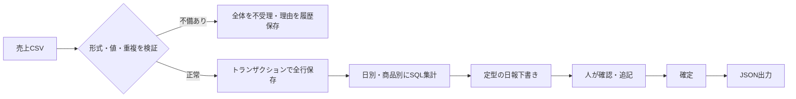
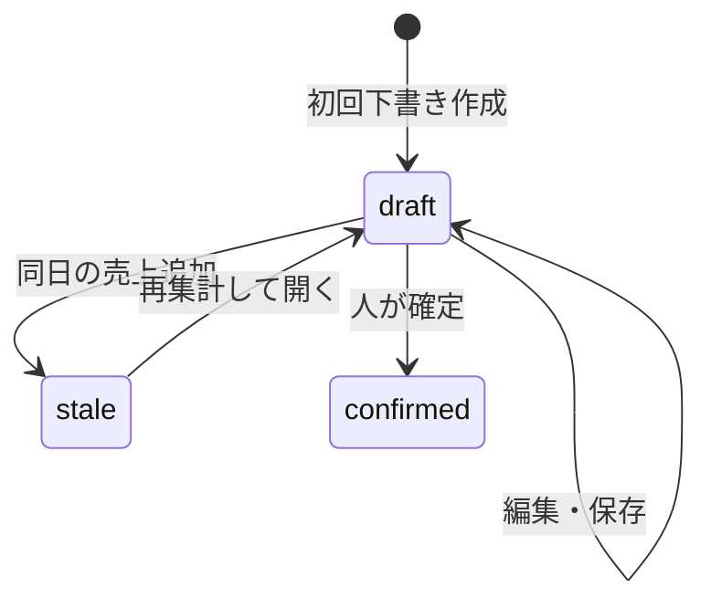

# 業務フローと設計

## 仮説

対象は1店舗の閉店作業。従来は「CSVを開く→数値の誤りを確認→表計算で集計→日報へ転記→共有」と想定。
このアプリでは「CSV取り込み→自動検証・集計→担当者が日報へ追記・確定→JSON保存」とします。
まだ実店舗へのヒアリングや効果測定を行ったわけではありません。

## データ契約

| CSV列      | 意味           | 制約                                        |
| ---------- | -------------- | ------------------------------------------- |
| sale_id    | 明細ID         | 英数字・`_`・`-`、1〜64文字。全データで一意 |
| sold_on    | 営業日         | 実在するYYYY-MM-DD形式                      |
| product    | 商品名         | 制御文字なし、1〜100文字                    |
| quantity   | 数量           | 1〜10,000の整数                             |
| unit_price | 税込単価（円） | 0〜1,000,000の整数                          |

列名・順序は固定、UTF-8（BOM可）、最大2MB・10,000行。不正な行だけを飛ばす方式にはしていません。
全角数値、小数、カンマ付き金額、負数は受け付けません。
sale_idは決済IDではなく明細IDです。同じ会計の複数商品にはそれぞれ異なる明細IDが必要です。

## DB

`imports`：ファイル名、SHA-256、成功／失敗、件数、理由、UTC時刻。成功した同一ハッシュには一意制約。

`sales`：明細ID、日付、商品名、数量、単価、取込ID。明細IDを主キーにして、ファイル名を変更した再取り込みも拒否。

`reports`：営業日、本文、状態、バージョン、更新時刻。1日1件。

## 整合性

1. CSV全行の値を検証する。
2. `BEGIN IMMEDIATE` で書き込みトランザクションを開始する。
3. DB内の重複ID、同じファイル、確定済み日報の日付を確認する。
4. 取り込み履歴と全明細を同じトランザクションで保存する。
5. 失敗時は明細を残さず、失敗履歴だけ別トランザクションで記録する。

複数要求が同時に届いても確認と登録の間に別の登録が入り込まないよう、書き込みを直列化しています。

## 日報の状態

保存・確定には現在の `version` が必要です。別の画面で先に保存された場合は409を返し、無意識の上書きを防ぎます。
確定した日報の解除は未実装。誤った取り込みの取消機能も今後の課題です。

## 想定される改善

CSVに行単位の修正ガイドをつける、集計値と自由記述を別管理する、承認者の権限を設ける、取消履歴と訂正手順を追加する。
効果測定は「同じサンプルを手作業とアプリで処理した時間」を計り、サンプル件数と測定条件も添えて比較します。
